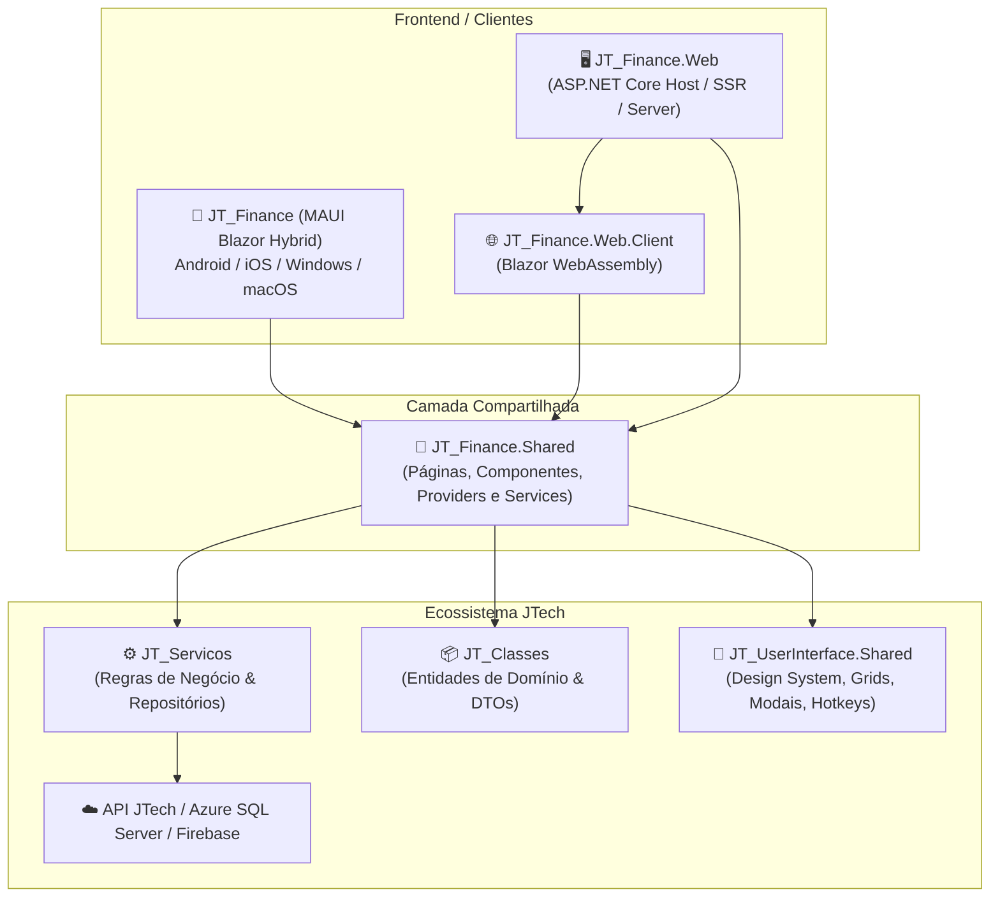

# 💰 JT_Finance - Sistema de Gestão Financeira Pessoal e Empresarial

O **JT_Finance** é uma solução completa e moderna para controle financeiro, planejamento orçamentário e análise de indicadores, desenvolvida com tecnologia de ponta no ecossistema **.NET 10** e **Blazor**.

Projetado sob uma arquitetura híbrida e multiplataforma, o sistema atende tanto usuários **Web** (via Blazor Server e WebAssembly interativo) quanto usuários **Mobile e Desktop** (via .NET MAUI Blazor Hybrid para Windows, Android, iOS e macOS), compartilhando 100% da lógica de negócio e dos componentes de interface de usuário.

---

## 📌 Visão Geral da Arquitetura

O ecossistema do **JT_Finance** é composto por uma solução modular:



### Projetos da Solução

| Projeto | Tipo | Descrição |
|---|---|---|
| **[JT_Finance.Shared](file:///c:/Users/sirja/source/repos/mrjalves/JT_Finance/JT_Finance/JT_Finance.Shared)** | Razor Class Library (.NET 10) | Contém todas as páginas (`Pages`), componentes (`Components`), modais, rotas e serviços do módulo financeiro. |
| **[JT_Finance.Web](file:///c:/Users/sirja/source/repos/mrjalves/JT_Finance/JT_Finance/JT_Finance.Web)** | ASP.NET Core Web App (.NET 10) | Host principal da aplicação Web. Fornece renderização estática e interativa (Server + WASM), endpoints Minimal APIs e cabeçalhos de segurança. |
| **[JT_Finance.Web.Client](file:///c:/Users/sirja/source/repos/mrjalves/JT_Finance/JT_Finance/JT_Finance.Web.Client)** | Blazor WebAssembly (.NET 10) | Camada executada diretamente no navegador do cliente para interatividade rica offline/SPA. |
| **[JT_Finance](file:///c:/Users/sirja/source/repos/mrjalves/JT_Finance/JT_Finance/JT_Finance)** | .NET MAUI Blazor Hybrid (.NET 10) | Aplicativo nativo multiplataforma para Windows 10/11, Android, iOS e macOS. |

---

## 🚀 Principais Funcionalidades

### 1. 📊 Dashboard Financeiro & Inteligência de Negócios (BI)
- **Cards de Indicadores (KPIs)**: Total de Receitas do Mês, Total de Despesas, Saldo Atual, Despesas Vencidas e Despesas Próximas ao Vencimento.
- **Gráficos Interativos**: Distribuição de despesas por categoria (Gráfico de Rosca/Doughnut) e por tipo (Gráfico de Barras).
- **Navegação Mensal Dinâmica**: Alterne entre meses passados e futuros com recalibração instantânea dos dados.
- **Construtor de Dashboards Personalizados**: Crie dashboards sob medida adicionando indicadores do catálogo do Data Warehouse (EDW).
- **Composição com IA (`DashboardIAComposer`)**: Gere layouts e indicadores financeiros a partir de descrições em linguagem natural (prompt), com prévia editável antes da confirmação.
- **Compartilhamento Público Seguro (`/compartilhado/{token}`)**: Compartilhe visualizações de snapshots de dashboards via tokens exclusivos, sem expor credenciais ou dados sensíveis.

### 2. 💸 Gestão de Despesas
- **Lançamentos Detalhados**: Cadastro com descrição, valor, data de ocorrência e vencimento.
- **Suporte a Despesas de Cartão de Crédito**: Vinculação a cartão específico, cálculo automático de parcelamento e associação às faturas correspondentes.
- **Classificação**: Categorias e tipos de despesa parametrizáveis.
- **Grade Avançada (`GridDespesas`)**: Paginação no servidor, ordenação por qualquer coluna, busca textual instantânea, filtros e barra de totais (Itens, Total, Pagas e Pendentes).
- **Ações Rápidas**: Edição, exclusão com confirmação e duplicação rápida de lançamentos.

### 3. 📈 Gestão de Receitas
- Cadastro de rendimentos, salários, investimentos e receitas esporádicas.
- Grade interativa com filtros, somatórios e atalhos de teclado.
- Associação com categorias financeiras integradas ao `IModuloCategoriaProvider`.

### 4. 💳 Cartões de Crédito & Gestão de Faturas
- **Controle de Cartões**: Definição de limites de crédito, dia de fechamento e dia de vencimento da fatura.
- **Visão Consolidada de Faturas (`/fatura/{CartaoId}`)**:
  - Agrupamento de lançamentos por mês/ano.
  - Cálculo de total em aberto, valor já pago e limite comprometido.
  - Expansão detalhada de itens da fatura com indicação de parcelas pagas/pendentes.
  - **Fluxo de Pagamento de Faturas**: Liquidação total ou parcial de faturas com registro de data de pagamento.

### 5. 🗓️ Histórico & Calendário Financeiro (`/historico`)
- Visualização mensal em formato de calendário interativo (`CalendarioBase`).
- Mapeamento diário de eventos de receitas e despesas para acompanhamento de fluxo de caixa no tempo.

### 6. 🛒 Listas de Compras (`/listacompras`)
- Criação e gerenciamento de múltiplas listas de compras.
- Registro de itens, quantidades, valores previstos e valores realizados.

### 7. 🤖 Recursos de Inteligência Artificial e Produtividade
- **Assistência por IA nos Formulários**: Integração com serviços de IA em modais e grids (`EnableIA="true"`).
- **Atalhos de Teclado Globais (Hotkeys)**: Navegação de alta produtividade para operações como "Novo" (`F2`/`Alt+N`), "Editar", "Excluir", gerenciadas pelo `HotkeysDisplayService`.

---

## 🛠️ Tecnologias Utilizadas

- **Framework**: [.NET 10](https://dotnet.microsoft.com/) (C# 13)
- **Frontend / UI**:
  - Blazor Server / Blazor WebAssembly / .NET MAUI Blazor Hybrid
  - [Bootstrap 5](https://getbootstrap.com/) & [Bootstrap Icons](https://icons.getbootstrap.com/)
  - [Chart.js](https://www.chartjs.org/) via wrapper Blazor interativo
  - Camada de componentes compartilhada: `JT_UserInterface.Shared`
- **Autenticação & Segurança**:
  - Firebase Authentication (`FirebaseAuthentication.net`)
  - Google OAuth 2.0 (Credentials para Android, Windows e Web)
  - Headers de segurança contra clickjacking, MIME-sniffing e isolamento de contexto (COOP, CSP, X-Frame-Options)
  - Identificação de Tenant/Cliente via header `X-Client-Config`
- **Armazenamento de Dados**:
  - Azure SQL Server / Microsoft SQL Server (`Microsoft.Data.SqlClient`)
  - `ISecureStorageService` com suporte a Web `localStorage` e armazenamento seguro nativo no MAUI
- **DevOps & Deploy**:
  - GitHub Actions com deploy contínuo via SSH/Rsync para VPS Linux gerenciada por `systemd`

---

## 💻 Estrutura de Diretórios

```
JT_Finance/
├── .github/
│   └── workflows/
│       └── deploy.yml                  # Pipeline CI/CD automatizado
├── JT_Finance/
│   ├── JT_Finance/                     # Projeto Mobile & Desktop (.NET MAUI)
│   │   ├── Platforms/                  # Código específico por plataforma (Android, iOS, Windows, Mac)
│   │   ├── Resources/                  # Ícones, Splash screens e fontes
│   │   ├── App.xaml / MainPage.xaml    # Shell nativo hospedando BlazorWebView
│   │   └── MauiProgram.cs              # Inicialização e DI do aplicativo nativo
│   │
│   ├── JT_Finance.Shared/              # Biblioteca Central Compartilhada
│   │   ├── Components/
│   │   │   ├── Grids/                  # Grids reutilizáveis (Despesas, Receitas, Cartões)
│   │   │   ├── Modais/                 # Modais com validação e suporte a IA
│   │   │   ├── DashboardIAComposer.razor # Compositor de dashboards via IA
│   │   │   └── Calendario.razor        # Componente de calendário de eventos
│   │   ├── Layout/                     # Menus, provedores de categorias e navegação
│   │   ├── Models/                     # ViewModels específicos (ex.: FaturaViewModel)
│   │   ├── Pages/                      # Páginas da aplicação (Home, Despesas, Receitas, etc.)
│   │   └── Services/                   # Serviços de frontend, cache e providers de indicadores
│   │
│   ├── JT_Finance.Web/                 # Host Web ASP.NET Core
│   │   ├── Program.cs                  # Pipeline HTTP, rotas, segurança e Minimal APIs
│   │   ├── appsettings.json            # Configurações de conexões e credenciais
│   │   └── Components/App.razor        # Host HTML inicial e scripts
│   │
│   └── JT_Finance.Web.Client/          # Cliente Blazor WebAssembly
│       ├── Program.cs                  # Inicialização no navegador (WASM)
│       └── wwwroot/                    # Assets estáticos do cliente WASM
│
├── docs/                               # Documentação Técnica Especializada
│   ├── ARQUITETURA.md                  # Padrões arquiteturais e fluxo de dados
│   ├── FUNCIONALIDADES.md              # Guia detalhado de casos de uso
│   └── CONFIGURACAO_E_DEPLOY.md        # Guia de configuração de ambiente e deploy
│
├── JT_Finance.sln                      # Solução do Visual Studio
└── README.md                           # Este documento
```

---

## ⚙️ Como Executar o Projeto Localmente

### Pré-requisitos
- [.NET 10.0 SDK](https://dotnet.microsoft.com/download) instalado.
- Visual Studio 2024 / 2026 (ou Visual Studio Code com a extensão C# Dev Kit).
- Para desenvolvimento Mobile: Workload `.NET MAUI` instalado (`dotnet workload install maui`).

### 1. Clonando o Repositório
```bash
git clone https://github.com/mrjalves/JT_Finance.git
cd JT_Finance
```

### 2. Executando a Versão Web
```bash
dotnet run --project JT_Finance/JT_Finance.Web/JT_Finance.Web.csproj
```
Acesse a aplicação no navegador em `https://localhost:7166` ou na porta configurada.

### 3. Executando a Versão Mobile / Desktop (.NET MAUI)
- **Windows Desktop**:
  ```bash
  dotnet build -t:Run -f net10.0-windows10.0.19041.0 JT_Finance/JT_Finance/JT_Finance.csproj
  ```
- **Android**:
  ```bash
  dotnet build -t:Run -f net10.0-android JT_Finance/JT_Finance/JT_Finance.csproj
  ```

---

## 📚 Documentação Adicional

Para aprofundar-se em tópicos específicos, consulte os guias em [docs/](file:///c:/Users/sirja/source/repos/mrjalves/JT_Finance/docs):
- 📘 [Arquitetura & Design do Sistema](file:///c:/Users/sirja/source/repos/mrjalves/JT_Finance/docs/ARQUITETURA.md)
- 📗 [Guia Completo de Funcionalidades & Telas](file:///c:/Users/sirja/source/repos/mrjalves/JT_Finance/docs/FUNCIONALIDADES.md)
- 📙 [Configuração de Ambiente, Firebase & Deploy CI/CD](file:///c:/Users/sirja/source/repos/mrjalves/JT_Finance/docs/CONFIGURACAO_E_DEPLOY.md)

---

## 👨‍💻 Autor e Licença

Desenvolvido por **Júlio Alves** — [JTech Sistemas](https://jtecsistemas.com.br)  
Todos os direitos reservados.