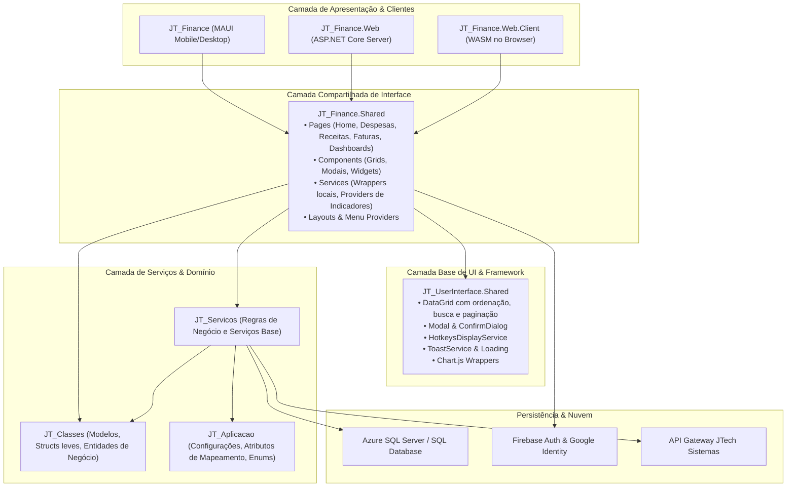
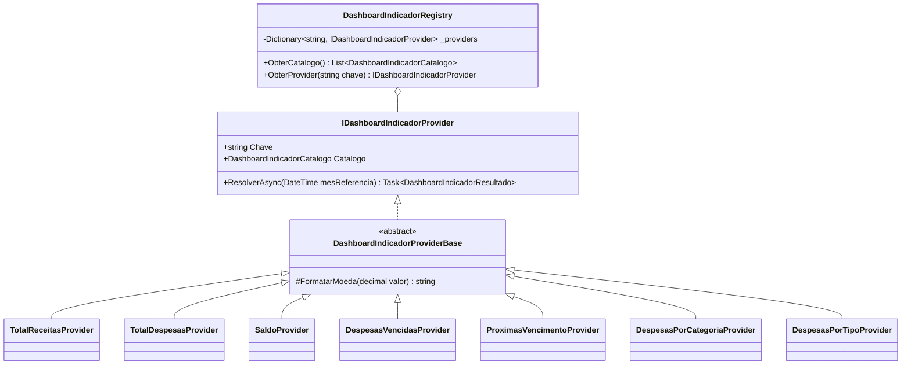
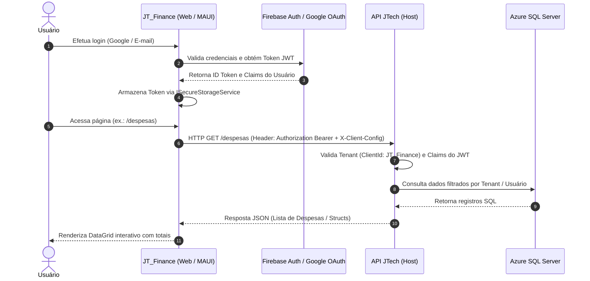

# 🏛️ Documento de Arquitetura de Software — JT_Finance

Este documento descreve detalhadamente as decisões de arquitetura, padrões de projeto, estrutura de camadas e mecanismos de comunicação adotados no projeto **JT_Finance**.

---

## 1. Visão Geral da Arquitetura

O **JT_Finance** utiliza o modelo arquitetural de **UI Compartilhada (Shared UI)** sobre a plataforma **.NET 10**, combinando:
1. **Blazor Web App** (renderização híbrida Server + WebAssembly) para acesso via navegadores web.
2. **.NET MAUI Blazor Hybrid** para distribuição nativa multiplataforma (Windows Desktop, Android, iOS e macOS).
3. **Ecosistema Modular JTech** (`JT_ApplicationLayer`), aproveitando serviços de dados compartilhados, persistência e componentes reutilizáveis.

### Diagrama de Camadas



---

## 2. Estrutura dos Projetos

### 2.1. `JT_Finance.Shared` (Biblioteca Central de Componentes)
A biblioteca central concentra toda a experiência de usuário do módulo financeiro:
- **`Pages/`**:
  - `Home.razor` & `Home.razor.cs`: Painel principal com métricas mensais (KPIs), gráficos de despesas por tipo/categoria e avisos de vencimento.
  - `Despesas.razor` & `Despesas.razor.cs`: Gestão de despesas com grid paginada, filtros rápidos, soma de totais e modais de cadastro.
  - `Receitas.razor`: Gestão de receitas e rendimentos.
  - `CartoesCredito.razor`: Gestão de cartões e limites.
  - `Fatura.razor` & `Fatura.razor.cs`: Visão agrupada das faturas mensais, histórico de parcelas e liquidação.
  - `Dashboards.razor`: Listagem de dashboards criados pelo usuário com atalho para o assistente de IA.
  - `DashboardEditor.razor`: Construtor visual de dashboards para compor e reordenar widgets.
  - `DashboardPublico.razor`: Visualizador read-only de dashboards compartilhados via token exclusivo.
  - `Historico.razor`: Calendário financeiro de fluxo de caixa mensal.
  - `ListaCompras.razor`: Organização de listas de compras e estimativas de preço.
  - `Configuracoes.razor`: Integração com as configurações financeiras do usuário e atalhos.
- **`Components/`**:
  - `Grids/`: `GridDespesas`, `GridReceitas`, `GridCartoesCredito` com renderização baseada no `DataGrid<TItem>`.
  - `Modais/`: `ModalDespesa`, `ModalReceita`, `ModalCartaoCredito`, todos com validação via `DataAnnotations` e integração com IA (`EnableIA="true"`).
  - `DashboardIAComposer.razor`: Modal assistente alimentado por LLM para sugerir e gerar widgets automaticamente.
  - `DashboardWidget.razor`: Renderizador dinâmico de cards ou gráficos com suporte a Chart.js.
  - `Calendario.razor`: Mapeador de despesas e receitas para o componente `CalendarioBase`.
- **`Services/`**:
  - Wrappers de serviço para despesas, receitas e cartões (`IDespesaService`, `IReceitaService`, `ICartaoCreditoService`).
  - Catálogo de Indicadores e Data Warehouse (`Dashboard/`).

---

### 2.2. `JT_Finance.Web` & `JT_Finance.Web.Client` (Modo Web)
O projeto Web implementa a arquitetura moderna de Blazor no .NET 10:
- **Render Modes Híbridos**:
  - O host inicial (`App.razor`) expõe `AddInteractiveServerRenderMode()` e `AddInteractiveWebAssemblyRenderMode()`.
  - Componentes estáticos carregam rapidamente via Server-Side Rendering (SSR) e ganham interatividade progressiva via WebAssembly ou SignalR.
- **Segurança no Pipeline HTTP**:
  ```csharp
  app.Use(async (context, next) =>
  {
      context.Response.Headers["Cross-Origin-Opener-Policy"] = "same-origin-allow-popups";
      context.Response.Headers["X-Content-Type-Options"] = "nosniff";
      context.Response.Headers["X-Frame-Options"] = "DENY";
      context.Response.Headers["Referrer-Policy"] = "strict-origin-when-cross-origin";
      await next();
  });
  ```
- **Minimal APIs Embutidas**:
  O servidor ASP.NET Core expõe endpoints leves para configurações financeiras, configurações de IA, hotkeys e permissões de acesso:
  - `GET/POST /api/configuracoes-financeiras`
  - `GET/POST /api/configuracoes-ia`
  - `GET/POST /api/configuracoes-hotkeys`
  - `GET/POST /api/configuracoes-acessos`

---

### 2.3. `JT_Finance` (.NET MAUI Blazor Hybrid)
O projeto MAUI compila para aplicações binárias nativas em múltiplas plataformas:
- **Janela e Web View Nativa**: Utiliza `Microsoft.AspNetCore.Components.WebView.Maui` para renderizar os componentes Razor com desempenho de 60fps local.
- **Tratamento de Conexões Locais Android**:
  Detecta em tempo de execução quando o app está emulador Android para substituir referências a `localhost` por `10.0.2.2`:
  ```csharp
  if (DeviceInfo.Platform == DevicePlatform.Android && baseAddressUrl.Contains("localhost"))
  {
      baseAddressUrl = baseAddressUrl.Replace("localhost", "10.0.2.2");
  }
  ```
- **Multi-Tenant e Configuração**: Injeta o cabeçalho `X-Client-Config` contendo o `ClientId = "JT_Finance"` codificado em Base64 para identificação automática no backend.

---

## 3. Padrões de Projeto & Boas Práticas

### 3.1. Padrão Provider & Catálogo Dinâmico (Dashboards)
Para permitir que novos indicadores sejam adicionados sem modificar o código de exibição dos dashboards, utiliza-se a abstração `IDashboardIndicadorProvider`:



Cada indicador encapsula:
- Nome, descrição e formato (`Card` numérico ou `Grafico` com Chart.js).
- Ícone do Bootstrap Icons e cor variante temática (`success`, `danger`, `primary`, `warning`).
- Cálculo e agregação independente a partir dos serviços de receitas ou despesas.

### 3.2. Gerenciamento de Estado & Cache Reativo no Frontend
Os serviços de UI (`DespesaService`, `ReceitaService`, `CartaoCreditoService`) implementam um padrão reativo simples baseado em eventos:
1. **Cache Local em Memória**: Mantém coleções privadas (`List<sDespesa>`, `List<Receita>`, `List<sCartao>`) para evitar requisições desnecessárias a cada renderização.
2. **Atualização Otimista / Seletiva**: Ao salvar ou excluir um item, o cache é atualizado pontualmente, e o evento `OnDataChanged` é disparado.
3. **Notificação Desacoplada aos Componentes**: Os componentes inscritos no evento (`Despesas.razor`, `Receitas.razor`) escutam `OnDataChanged` e executam `StateHasChanged()` ou recarga controlada sem recarregar a página inteira.

### 3.3. Abstração de Armazenamento Seguro (`ISecureStorageService`)
- No **Blazor Web (WebAssembly/Server)**, a persistência de tokens JWT e credenciais é gerenciada por `WebSecureStorageService`, que invoca `localStorage` via JavaScript Interop com proteção contra exceções durante o prerendering (`InvalidOperationException`).
- No **.NET MAUI**, a implementação utiliza a API nativa segura do sistema operacional (Android Keystore, Apple Keychain e Windows Data Protection API).

---

## 4. Integração com IA (Artificial Intelligence)

O **JT_Finance** conta com suporte nativo a assistentes de IA:
1. **Compositor de Dashboards por Prompt (`DashboardIAComposer`)**:
   - O usuário digita um prompt em linguagem natural (ex.: *"Monte um dashboard mensal com saldo atual, distribuição de despesas por categoria e contas vencidas"*).
   - O serviço de IA analisa as intenções e monta uma estrutura de dashboard preliminar com os indicadores do catálogo do Data Warehouse.
   - O usuário pode visualizar a prévia, renomear widgets e reordená-los antes de efetivar o salvamento.
2. **Assistência em Formulários (`EnableIA="true"`)**:
   - Modais de cadastro passam o contexto da entidade atual (`EntidadeContexto="@Despesa"`) para sugerir preenchimentos automáticos ou categorizações inteligentes.

---

## 5. Fluxo de Dados e Autenticação


